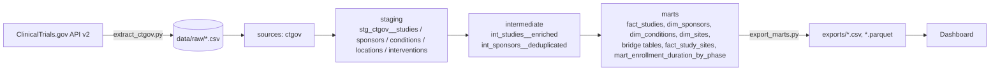
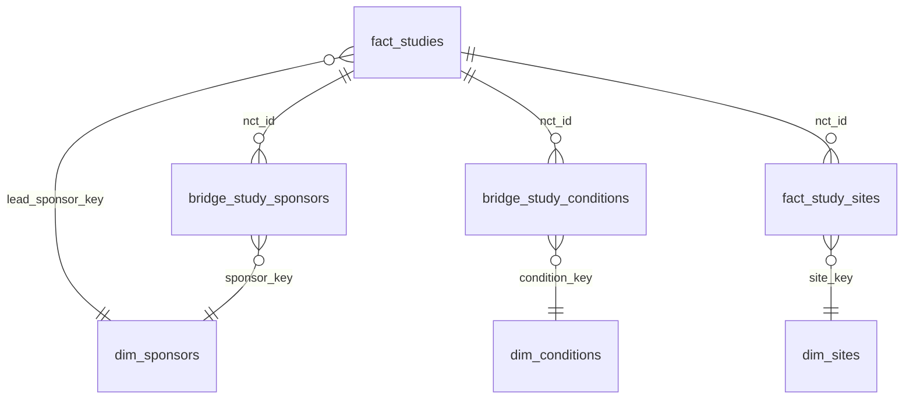

# Clinical Trials Analytics: dbt + DuckDB case study

**Turning the public ClinicalTrials.gov registry into a tested, analysis-ready star schema.**

## The problem
A research-operations team wants to benchmark completed oncology trials: how large they are, how long they take, who sponsors them, where they run, and how reliably results get posted. The registry's API returns deeply nested JSON with partial dates, free-text conditions, duplicated site rows and inconsistent sponsor naming. Analysts were re-cleaning the same data in spreadsheets for every question.

## The approach
- **Extract:** a small Python script (`extract/extract_ctgov.py`) pulls a reproducible slice from the ClinicalTrials.gov API v2 and flattens it into five raw CSVs.
- **Model:** dbt on DuckDB, layered as sources, then staging, intermediate and marts, using the same conventions you'd use on Snowflake (the SQL ports with minimal changes).
- **Test:** 48 data tests, including generic, `dbt_utils` and singular reconciliation tests, run on every build and in CI.
- **Deliver:** the mart tables are exported to CSV and Parquet for BI tools (Power BI, Tableau, Streamlit).

**Dataset slice:** COMPLETED, INTERVENTIONAL studies matching the condition "cancer", with start dates from 2015-01-01 to 2016-12-31 and last updated on or before 2026-09-30, so re-running the extract reproduces the slice.

## Architecture


## Data model


| Model | Grain | Rows |
|---|---|---|
| fact_studies | one study | 4,288 |
| dim_sponsors | one organization | 2,573 |
| dim_conditions | one normalized condition | 3,396 |
| dim_sites | one facility + city + state + country | 28,940 |
| bridge_study_sponsors | study × organization × role | 7,239 |
| bridge_study_conditions | study × condition | 8,624 |
| fact_study_sites | study × site | 48,710 |
| mart_enrollment_duration_by_phase | phase × sponsor class | 36 |

Key cleaning rules:
- Month-only dates (`2016-05`) resolve to the 1st of the month (`parse_ctgov_date` macro).
- Combined phases are normalized to `PHASE1/2` and `PHASE2/3`.
- Conditions are grouped case-insensitively with whitespace collapsed.
- Duplicate site rows are removed.
- When a sponsor name appears with more than one class, its most frequent class wins.

## Tests and quality
`dbt build` runs **15 models and 48 tests, all passing**:
- `unique` and `not_null` on every primary and surrogate key
- `relationships` from every bridge table and fact to its dimensions
- `accepted_values` on status, study type, phase, sponsor role, sponsor class and intervention type
- `dbt_utils.unique_combination_of_columns` on the bridge tables, and `accepted_range` on enrollment
- Singular tests:
  - completion date is never before the start date
  - fact `site_count` reconciles exactly with `fact_study_sites`
  - every study falls inside the slice window

SQL is linted with **sqlfluff** (dbt templater). **GitHub Actions** runs deps, build, lint and export on every push and pull request.

## Results (from the actual build)
**4,288 completed cancer trials enrolled 784,777 participants. The median trial enrolled 53 people, and 34.1% posted results.**

| Phase | Studies | Participants | Median enrollment | Median duration (months) |
|---|---|---|---|---|
| Not applicable | 1,489 | 439,956 | 67 | 32.0 |
| Phase 2 | 1,006 | 80,908 | 47 | 58.0 |
| Phase 1 | 831 | 41,878 | 27 | 46.5 |
| Phase 3 | 353 | 143,505 | 300 | 58.4 |
| Phase 1/2 | 346 | 26,326 | 47 | 57.2 |
| Phase 4 | 124 | 37,319 | 70 | 30.3 |

Results-posting rate by lead sponsor class:

| Sponsor class | Studies | % with results | Median days to results |
|---|---|---|---|
| Academic / other | 2,919 | 26.0% | 401 |
| Industry | 1,185 | 52.6% | 413 |
| NIH | 58 | 72.4% | 72 |

Other findings:
- Industry sponsors post results twice as often as academic centers.
- Top lead sponsors: MD Anderson (103), Fuda Cancer Hospital (61), Roche (57), Memorial Sloan Kettering (54) and NCI (51).
- The US hosts 2,073 of the trials across 19,976 study-site links, followed by France (518) and China (401).
- Breast cancer is the most common condition (330 studies).

All of these queries are in `scripts/insights.sql`.

## How to run
```bash
git clone <this repo> && cd clinical-trials-dbt
make all          # creates .venv, installs deps, runs dbt build, exports marts
make insights     # prints the result tables above
make extract      # optional: re-pull raw data from the API
make docs         # dbt docs site with lineage graph
```
Without `make`:
```bash
pip install -r requirements.txt
export DBT_PROFILES_DIR=.
dbt deps
dbt build
python scripts/export_marts.py
```

## Repository layout
```
extract/            API extract script
data/raw/           raw CSV landing files (about 6 MB)
models/staging      stg_ models and source definitions
models/intermediate int_ models
models/marts        dim_ / fact_ / bridge_ / mart_ models
tests/              singular tests
macros/             date parsing and schema naming
scripts/            mart export and insight queries
exports/            CSV and Parquet extracts of the marts
```

*Data source: ClinicalTrials.gov, U.S. National Library of Medicine (public domain). This is an independent analysis for portfolio purposes.*
